# 🛡️ Enterprise Multi-Zone Network & Windows Server 2025 Security Hardening (Graduation Project - Task 1)

## 📌 Project Overview
**Task 1** of the **Automated Security Response System for Enterprise Networks** graduation project. This foundational phase builds and secures an enterprise-grade, multi-zone network architecture in **GNS3**, protected at the perimeter by a **FortiGate Next-Generation Firewall (NGFW)** with **Virtual IP (DNAT)** port forwarding, hosting core enterprise services (**AD DS, DNS, Web, FTP, and File Sharing**) in a segmented **DMZ**, and enforcing **14 Security Policies** alongside **Least-Privilege Role-Based Access Control (RBAC)** across **Windows 10** and **Ubuntu Linux** endpoints.

---

## 🏗️ Network Architecture & IP Addressing

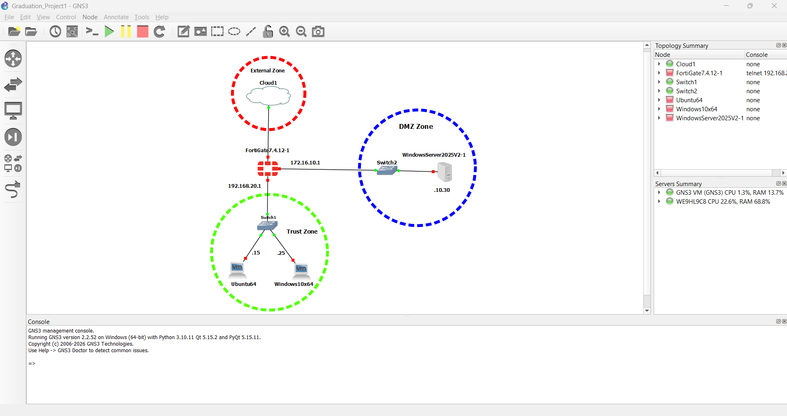

The infrastructure is segmented into three isolated security zones governed by **FortiGate 7.4.12**:

| Security Zone | FortiGate Interface | Gateway IP | Connected Nodes | Endpoint IPs | Security Role |
| :--- | :--- | :--- | :--- | :--- | :--- |
| **External Zone (WAN)** | `Port1` | `192.168.1.5` (DHCP/NAT) | `Cloud1` (`eth1`) | External / ISP | Untrusted external network & internet access |
| **DMZ Zone** | `Port2` | `172.16.10.1/24` | `Switch2` ➔ `WindowsServer2025V2-1` | `172.16.10.30` | Core Infrastructure & Enterprise Services (AD, DNS, Web, FTP, SMB) |
| **Trust Zone (LAN)** | `Port3` | `192.168.20.1/24` | `Switch1` ➔ `Ubuntu64` & `Windows10x64` | `.15` (Ubuntu) `.25` (Win10) | Hardened internal corporate workstations (Windows & Linux) |

---

## 🔥 FortiGate NGFW: Firewall Policies & Virtual IPs

### 1. Firewall Policies & NAT Rules
Strict stateful access control policies regulate all inter-zone communication across `WAN (port1)`, `DMZ (port2)`, and `LAN (port3)` interfaces (enforcing a default **Implicit Deny** for any unmatched traffic):

| Policy Name | Incoming Interface | Outgoing Interface | Source | Destination | Service | Action & NAT |
| :--- | :--- | :--- | :--- | :--- | :--- | :--- |
| **`LAN_to_Internet`** | `LAN (port3)` | `WAN (port1)` | `LAN_Subnet` (`192.168.20.0/24`) | `all` | `ALL` | **ACCEPT** (NAT Enabled) |
| **`Ubuntu_to_DMZ`** | `LAN (port3)` | `DMZ (port2)` | `Ubuntu64` (`192.168.20.15`) | `DC_DMZ` (`172.16.10.30`) | `DNS, FTP, SMB` | **ACCEPT** (NAT Disabled) |
| **`To_Internet`** | `DMZ (port2)` | `WAN (port1)` | `DC_DMZ` (`172.16.10.30`) | `all` | `ALL` | **ACCEPT** (NAT Enabled) |
| **`PC2 to DMZ`** | `LAN (port3)` | `DMZ (port2)` | `PC2_Win10` (`192.168.20.25`) | `DC_DMZ` (`172.16.10.30`) | `Windows AD, NTP, HTTP, FTP, SMB` | **ACCEPT** (NAT Disabled) |
| **`EXT to DMZ`** | `WAN (port1)` | `DMZ (port2)` | `IPS TEAM` | `External to DMZ` (VIP) | `HTTP` | **ACCEPT** (DNAT via Virtual IP) |
| **`Implicit Deny`** | `any` | `any` | `all` | `all` | `ALL` | **DENY** (Default Zero-Trust Rule) |

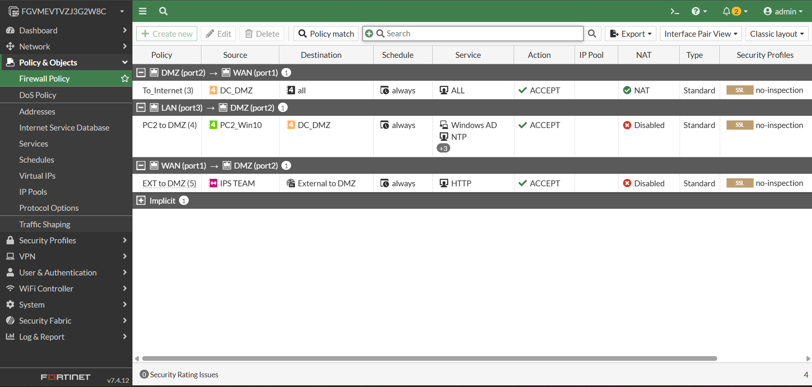

### 2. Virtual IP (VIP / DNAT Port Forwarding)
To securely publish the DMZ-hosted Web Server to external clients without exposing the internal DMZ subnet (`172.16.10.0/24`), a **FortiGate Virtual IP (Static NAT)** was configured on `WAN (port1)`:

| VIP Name | Interface | Mapped From (External) | Mapped To (Internal DMZ) | Published Service |
| :--- | :--- | :--- | :--- | :--- |
| **`External to DMZ`** | `WAN (port1)` | `192.168.1.5` (`TCP: 80`) | `172.16.10.30` (`TCP: 80`) | Enterprise Web Server (IIS) |

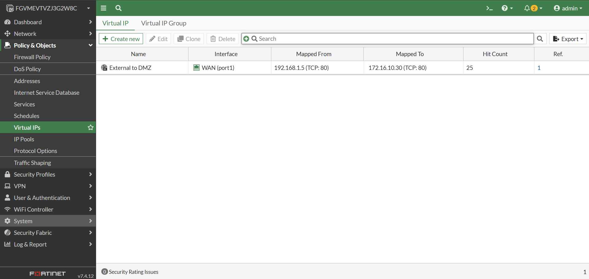

---

## 🖥️ Hosted Enterprise Services (DMZ Zone)

The DMZ server (`WindowsServer2025V2-1` — `172.16.10.30`) hosts core organizational infrastructure and network services accessible under controlled firewall policies:

- **Active Directory Domain Services (AD DS) & DNS (`faresismael.com`):** Centralized identity management, Kerberos authentication, internal name resolution (`ftp.dns.local`), and Group Policy distribution.
- **Web Server (IIS — HTTP):** Hosts the corporate web portal reachable from internal Trust workstations (`http://172.16.10.30`) and external clients via FortiGate Virtual IP (`192.168.1.5:80`).
- **FTP Server (File Transfer Protocol):** Configured with authentication and directory isolation, verified directly from the Ubuntu Linux workstation (`ftp://ftp.dns.local`).
- **File Sharing Server (SMB / Network Shares):** Configured centralized department shared folders (`File_Share`) protected with granular **NTFS** and **Share-level permissions**, verified across both Windows 10 and Ubuntu Linux clients.

---

## 🏢 Active Directory Hierarchy & Privilege Separation (RBAC)

Within **`faresismael.com`**, objects are organized under the root container **`ECE_Grad_Project`** across four dedicated Organizational Units (OUs):

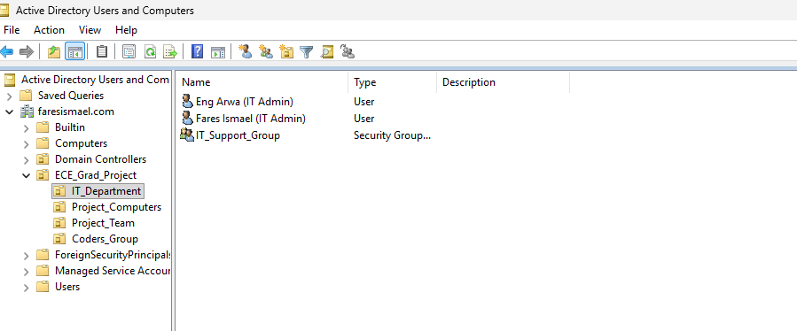

1. **`Project_Team` (Standard Users):** Contains general employee accounts governed by strict endpoint restrictions.
2. **`Project_Computers` (Workstations):** Contains domain-joined client machines (`Windows10x64` / `DESKTOP-8INU3L7`).
3. **`IT_Department` (Technical Support):** Contains `IT_Support_Group` and dedicated IT admin accounts (`Fares Ismael (IT Admin)` and `Eng Arwa (IT Admin)`).
4. **`Coders_Group` (Developers & Creative Designers):** Contains technical/design team members (`Esraa`, `Qusai`, `Mustafa`) who require local installation rights (fonts, creative suites, dev tools) while remaining restricted from altering network, USB, registry, or domain settings.

### 🔐 Least-Privilege Administration & Scoped Local Admin
To prevent privilege escalation and protect the Domain Controller, non-domain-admin roles are governed through three granular access tiers:
* **Delegation of Control (`IT_Support_Group`):** Delegated authority exclusively on `Project_Team` OU, allowing IT support staff to inspect user details and reset employee passwords without accessing the Domain Controller.
* **Restricted Groups (`GPO_12`):** Grants `IT_Support_Group` and `Coders_Group` **Local Administrator** privileges on `Project_Computers` workstations (while preserving `Domain Admins`), enabling software/font installation and local maintenance without domain-level control.
* **Policy-Scoped Local Admins (`Coders_Group` GPOs):** Even with Local Administrator access on their workstations, `Coders_Group` members remain bound by targeted User GPOs (`GPO_03`, `GPO_04`, `GPO_06`, `GPO_13`) that block NIC/IP tampering, USB data exfiltration, Registry edits, and leaving the domain.

| Account Lockout Policy (`Default Domain Policy`) | Restricted Groups (`Local Administrators`) |
| :---: | :---: |
| 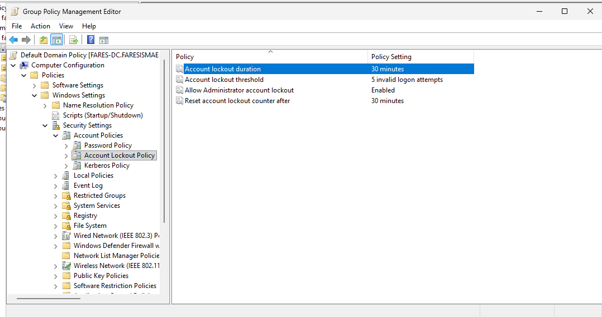 | 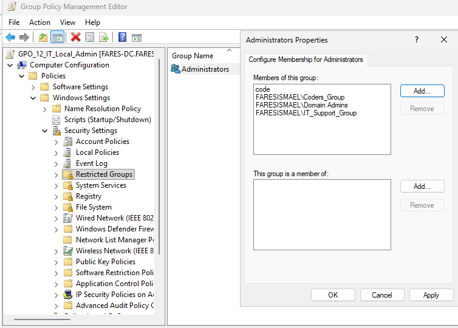 |

---

## 📜 Security Hardening Policies (13 GPOs + Domain Lockout)

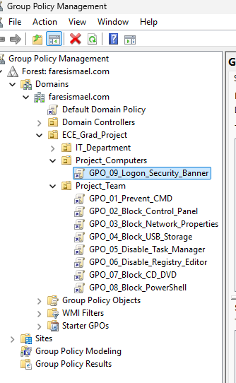

### A. User-Side Hardening (`Project_Team` & `Coders_Group` OUs)
| GPO Name | Target OU | Scope | Security Objective |
| :--- | :--- | :--- | :--- |
| **`GPO_01_Prevent_CMD`** | `Project_Team` | User | Disables Command Prompt (`cmd.exe`) and batch script execution. |
| **`GPO_02_Block_Control_Panel`** | `Project_Team` | User | Blocks access to Control Panel and Windows Settings to prevent system tampering. |
| **`GPO_03_Block_Network_Properties`** | `Project_Team` & `Coders_Group` | User | Locks TCP/IP and NIC properties to prevent IP/DNS spoofing or firewall bypass. |
| **`GPO_04_Block_USB_Storage`** | `Project_Team` & `Coders_Group` | User | Denies read/write access to removable USB drives to prevent data exfiltration. |
| **`GPO_05_Disable_Task_Manager`** | `Project_Team` | User | Disables Task Manager to prevent users from terminating security/monitoring processes. |
| **`GPO_06_Disable_Registry_Editor`** | `Project_Team` & `Coders_Group` | User | Blocks Registry Editor (`regedit.exe`) to protect core OS security keys. |
| **`GPO_07_Block_CD_DVD`** | `Project_Team` | User | Restricts CD/DVD optical media access as an additional DLP layer. |
| **`GPO_08_Block_PowerShell`** | `Project_Team` | User | Blocks Windows PowerShell execution to mitigate unauthorized scripting attacks. |
| **`GPO_13_Prevent_Leave_Domain`** | `Coders_Group` | User | Restricts Control Panel/System Settings for local-admin developers/designers so they cannot unjoin workstations from the domain. |

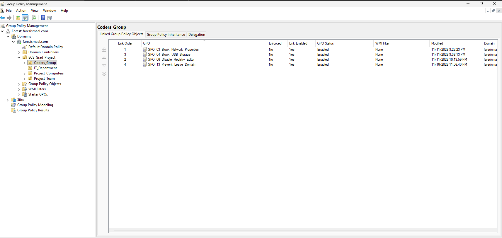

### B. Computer-Side & Domain-Wide Policies
| Policy Name | Target | Scope | Security Objective |
| :--- | :--- | :--- | :--- |
| **`GPO_09_Logon_Security_Banner`** | `Project_Computers` | Computer | Displays an authorized-use legal warning banner prior to Windows logon. |
| **`GPO_10_Disk_Quota_5GB`** | `Project_Computers` | Computer | Enforces a strict **5 GB per-user NTFS disk quota** to prevent storage exhaustion. |
| **`GPO_11_BitLocker_Encryption`** | `Project_Computers` | Computer | Configures BitLocker OS drive encryption policy (with non-TPM support for virtualized environments). |
| **`GPO_12_IT_Local_Admin`** | `Project_Computers` | Computer | Grants `IT_Support_Group` and `Coders_Group` Local Administrator rights on workstations via `Restricted Groups`. |
| **`Account Lockout Policy`** | `Default Domain Policy` | Domain | Protects against brute-force attacks by locking accounts for **30 minutes** after **5 invalid logon attempts**. |

---

## ✅ End-to-End Testing & Verification

All firewall rules, Virtual IPs, DMZ network services, outbound NAT, and GPO restrictions were validated end-to-end across both Windows and Linux clients:

1. **Pre-Logon Banner & Standard User Restrictions (`Project_Team`):**
   * Verified the custom legal warning banner prior to Windows logon (`GPO_09`).
   * Confirmed immediate access denial when attempting to launch `CMD`, `Control Panel`, `PowerShell`, `Task Manager`, or open **CD/DVD** (`D:\`) and **USB** drives.
   * Verified **BitLocker** drive encryption enforcement (`GPO_11`) and **Account Lockout** after 5 failed login attempts.
2. **IT Support Elevation (`Fares-IT`):**
   * Logged into `Windows10x64` using `Fares-IT`; verified bypass of user restrictions and full Local Admin access (`cmd.exe` and gateway reachability) without Domain Admin rights.
3. **DMZ Services & Internet Access Verification (`Windows 10` & `Ubuntu Linux`):**
   * **Windows 10 Client:** Verified HTTP access to the **IIS Web Server** (`172.16.10.30/`), SMB network shares (`\\172.16.10.30\File_Share`), and outbound internet connectivity through FortiGate NAT.
   * **Ubuntu Linux Client (`Ubuntu64`):** Verified cross-platform connectivity to the DMZ **FTP Server** (`ftp://ftp.dns.local`) and **SMB Windows File Shares** (`172.16.10.30` / `File_Share`).

### A. Endpoint Hardening & RBAC Verification
| Pre-Logon Security Banner (`GPO_09`) | BitLocker Drive Encryption (`GPO_11`) |
| :---: | :---: |
| 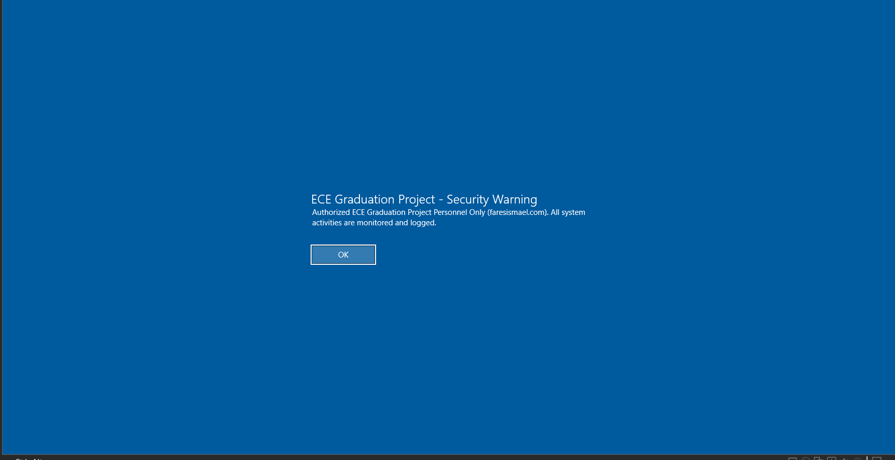 | 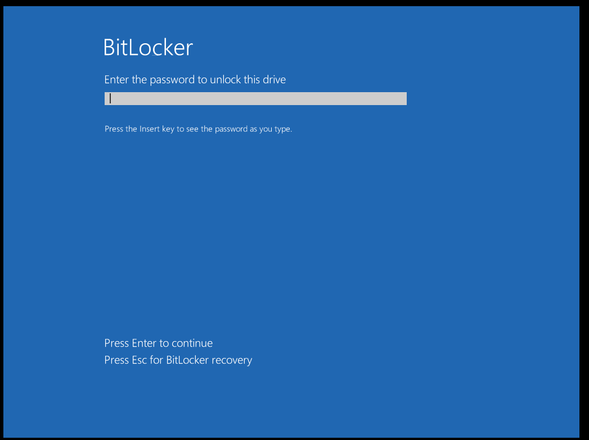 |

| System Tools Blocked (`Restrictions`) | Removable Media Blocked (`CD/DVD` Access Denied) |
| :---: | :---: |
| 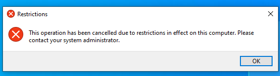 | 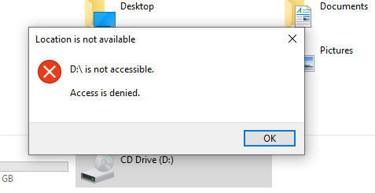 |

| IT Support Full Admin Access (`Fares-IT` CMD) |
| :---: |
| 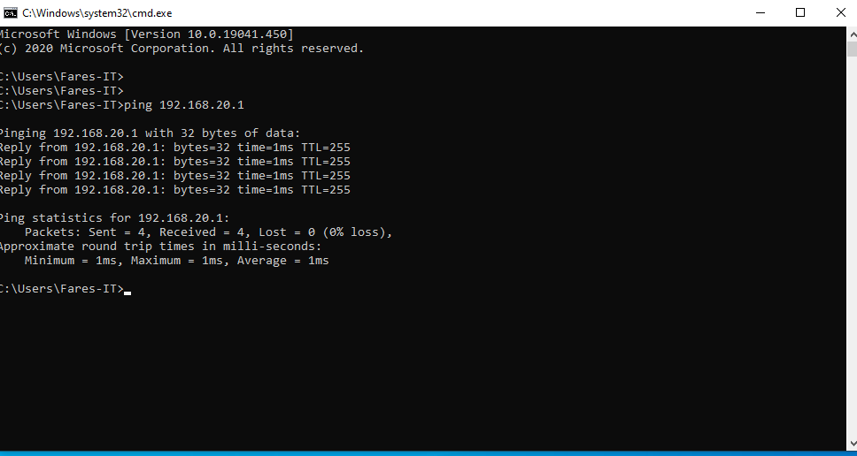 |
---

## 🛠️ Tech Stack & Tools
- **Network Simulation:** GNS3 v2.2.52 + GNS3 VM
- **Next-Gen Firewall:** Fortinet FortiGate VM (v7.4.12)
- **Server OS & Services:** Windows Server 2025 (AD DS, DNS, GPO, IIS Web, FTP, SMB File Sharing)
- **Client OS:** Windows 10 Pro (x64) & Ubuntu Linux (x64)

---

## Future Enhancements

- **Management VLAN (VLAN 40)** — A dedicated out-of-band VLAN for secure device management (SSH to firewalls/switches), isolated from user and server data traffic and restricted by ACLs to an admin host.
- **SIEM/XDR & MITRE ATT&CK Integration (Wazuh + Sysmon)** — Deploying Wazuh agents and Sysmon across Windows and Linux endpoints for centralized log ingestion, real-time alerting, and MITRE ATT&CK technique mapping.
- **AI Risk Scoring Engine** — Building an intelligent risk analysis module that evaluates incoming SIEM alerts and assigns dynamic severity scores (0–100) to prioritize critical threats.
- **Automated Incident Response & SOAR (Ansible & Python)** — Automating containment playbooks to trigger zero-touch attacker IP blocking on FortiGate/iptables, endpoint quarantine, and automated recovery.
- **Software-Defined Networking (SDN)** — Integrating Ryu Controller and Open vSwitch (OVS) for programmable flow-level traffic isolation.
- **Red Team Attack Simulation (Kali Linux)** — Validating the full detection-to-recovery pipeline (`Attack → Detect → Alert → Automate → Isolate → Recover`) using Hydra, Nmap, and Metasploit.

---

## Author

**Fares Ismael** | Sphinx University

[LinkedIn](https://www.linkedin.com/in/fares-ismael-058976425/)
